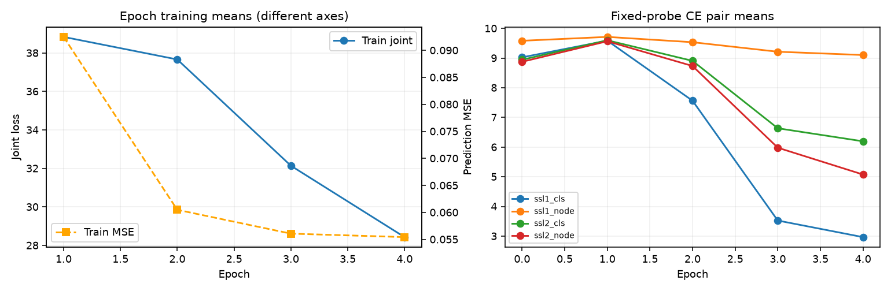
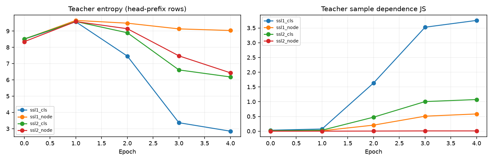
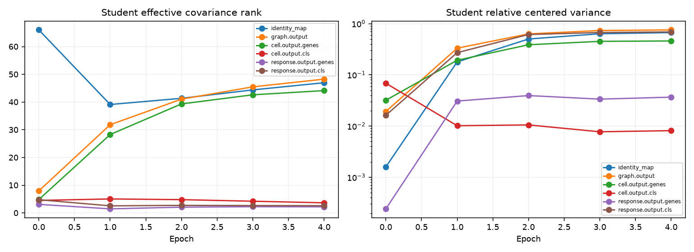
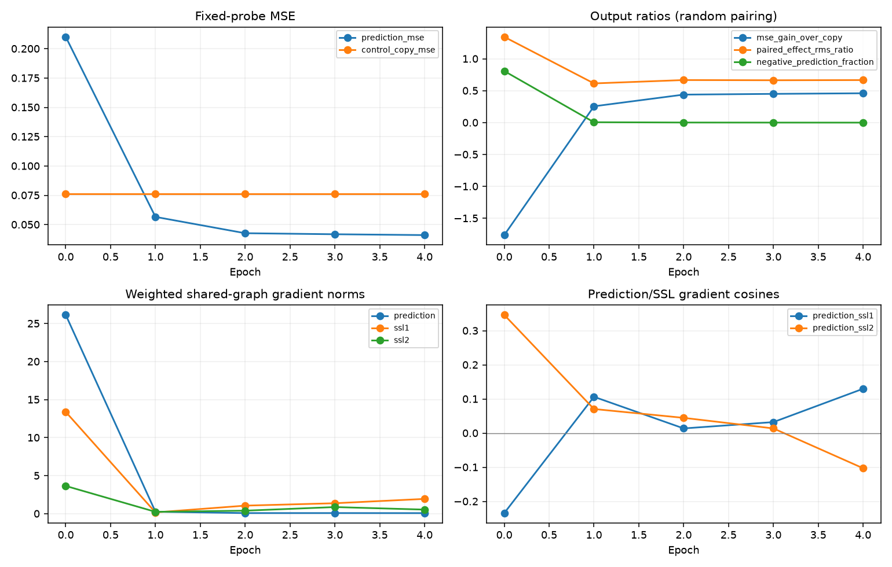

# DP：训练过程与最终评估分析

运行 `nadig_jurkat-seed1-20261014T060444Z-f53ca749778b42b5a48ab79e23647df9`；已完成 4 epoch，评估最后一轮 last.pt。
训练SHA `420d3a1ecf0ca05a88859ae2c2457fa85a126ef0`；评估SHA `420d3a1ecf0ca05a88859ae2c2457fa85a126ef0`；分析SHA `ae92f9db7f4f511b0f9d88238d707129bdda20d8`。
checkpoint SHA256 `f0800c5ebdc7d6b670bcc46a922180ddf7d4388650980795ab89afa12e6544da`。完整身份及每个输入hash见 [summary.json](summary.json)。

## 训练损失和耗时

| Epoch | 预测MSE | Joint | 训练分钟 | 诊断秒 |
|---|---:|---:|---:|---:|
| 1 | 0.092494 | 38.8348 | 47.34 | 31.36 |
| 2 | 0.060488 | 37.6629 | 47.29 | 31.30 |
| 3 | 0.056076 | 32.1390 | 47.40 | 31.49 |
| 4 | 0.055432 | 28.4306 | 47.23 | 31.27 |

Joint逐轮值为训练更新的平均；下文为固定训练探针，不能互换。

## 四个蒸馏头

以下是最终Teacher分布前缀统计：JS=边际熵−样本平均熵，越大表示此探针中样本目标越不同。

| 头 | 样本熵 | JS：初始化→最终 | 有效边际原型 | argmax使用数/样本数 | 最大argmax占比 |
|---|---:|---:|---:|---:|---:|
| ssl1_cls | 2.8488 | 0.0335→3.7586 | 740.5 | 103/128 | 4.7% |
| ssl1_node | 9.0371 | 0.0186→0.5852 | 15098.0 | 86/128 | 7.0% |
| ssl2_cls | 6.1819 | 0.0154→1.0740 | 1416.4 | 4/8 | 25.0% |
| ssl2_node | 6.4353 | 0.0002→0.0097 | 629.6 | 1/128 | 100.0% |

实际CE配对另行分解：CE=H(Teacher)+KL(Teacher‖Student)。它与上表采样行可能不同。

| 头 | CE：初始化→最终 | Teacher熵：初始化→最终 | KL：初始化→最终 |
|---|---:|---:|---:|
| ssl1_cls | 9.0250→2.9667 | 8.5002→2.8480 | 0.5248→0.1187 |
| ssl1_node | 9.5838→9.1034 | 8.5020→9.0079 | 1.0818→0.0956 |
| ssl2_cls | 8.9449→6.1959 | 8.5179→6.1819 | 0.4270→0.0140 |
| ssl2_node | 8.8749→5.0760 | 8.3598→5.0466 | 0.5151→0.0294 |

## 基因token、CLS及投影瓶颈

有效秩为 exp(协方差特征值归一化后的熵)；相对方差为中心化方差/未中心化二阶矩。高秩不直接等于生物学有效。

| Student位置 | 有效秩：初始化→最终 | 相对方差：初始化→最终 | 最终采样行数 |
|---|---:|---:|---:|
| identity_map | 66.03→46.98 | 0.0015943→0.66918 | 128 |
| graph.output | 7.97→48.28 | 0.01925→0.75507 | 128 |
| cell.output.genes | 4.85→44.14 | 0.031951→0.45929 | 128 |
| cell.output.cls | 4.53→3.67 | 0.068577→0.0081454 | 20 |
| response.output.genes | 3.11→2.23 | 0.00024194→0.03672 | 128 |
| response.output.cls | 4.78→2.64 | 0.016247→0.69 | 20 |
| ssl1_cls.bottleneck | 3.33→30.80 | 0.26783→0.88812 | 128 |
| ssl1_node.bottleneck | 16.44→13.76 | 0.3505→0.81344 | 128 |
| ssl2_cls.bottleneck | 4.59→2.69 | 0.017992→0.71885 | 16 |
| ssl2_node.bottleneck | 29.45→1.62 | 7.2934e-05→0.0058726 | 128 |

所有Student/Teacher逐层统计见features.csv，CLS样本包含重复视图；不能与128个gene行直接比秩上限。

## 输出行为和梯度关系

固定训练探针：预测MSE **0.041067**，复制control的MSE **0.076047**，相对降低 **46.0%**。
预测Δ RMS **0.1839**，随机配对真实效应RMS比 **0.6667**；负预测占比 **0.0%**；误差最大的1%元素贡献 **18.5%**。
这些查询只来自训练可见表达基因；该效应比不是生物学反事实幅度校准，也不描述未见表达组。

| 共享参数组 | ∥预测梯度∥ | ∥SSL1梯度∥ | ∥SSL2梯度∥ | cos(预测,SSL1) | cos(预测,SSL2) |
|---|---:|---:|---:|---:|---:|
| graph | 0.07786 | 1.947 | 0.5402 | 0.1300 | -0.1028 |
| graph.adapter | 0.07547 | 1.702 | 0.5257 | 0.1518 | -0.1077 |
| graph.layers | 0.01907 | 0.8202 | 0.1238 | 0.0126 | -0.0215 |

梯度已含实际loss权重；大梯度或负余弦需要结合跨轮轨迹，不能单次判定辅助目标无效。

## 最终测试：全部、表达见过、表达未见过

| 分组 | 指标 | Pearson | 有效/总条件 |
|---|---|---:|---:|
| all | txpert_macro_pearson_delta_all | 0.227482 | 592/592 |
| all | txpert_macro_pearson_delta_deg | 0.392913 | 590/592 |
| all | trishift_pearson_delta_all | 0.171467 | 592/592 |
| all | trishift_pearson_delta_deg | 0.359665 | 590/592 |
| all | systema_pearson_all | 0.091836 | 592/592 |
| all | systema_pearson_deg | 0.226782 | 590/592 |
| seen_expression | txpert_macro_pearson_delta_all | 0.400120 | 592/592 |
| seen_expression | txpert_macro_pearson_delta_deg | 0.470903 | 590/592 |
| seen_expression | trishift_pearson_delta_all | 0.291824 | 592/592 |
| seen_expression | trishift_pearson_delta_deg | 0.435580 | 590/592 |
| seen_expression | systema_pearson_all | 0.214057 | 592/592 |
| seen_expression | systema_pearson_deg | 0.274688 | 590/592 |
| unseen_expression | txpert_macro_pearson_delta_all | 0.123661 | 592/592 |
| unseen_expression | txpert_macro_pearson_delta_deg | 0.198190 | 147/592 |
| unseen_expression | trishift_pearson_delta_all | 0.113317 | 592/592 |
| unseen_expression | trishift_pearson_delta_deg | 0.159583 | 147/592 |
| unseen_expression | systema_pearson_all | -0.003066 | 592/592 |
| unseen_expression | systema_pearson_deg | 0.059854 | 147/592 |

最终测试MSE **0.005192**；与上述训练探针MSE属于不同数据/采样口径。

## 自动诊断线索与边界

- ssl2_node：128个前缀样本的argmax高度集中（100.0%），JS=0.0097213，有效边际原型=629.6。这是目标差异不足的检查线索；不是单原型坍塌的充分证明。
- 图输出有效秩48.28，Response基因输出有效秩2.23：检查信息是否在下游汇总时集中到少数方向，不能仅由秩判断预测能力。
- 单seed、固定小探针；与其他实验比较表征前先比较fixed_input_sha256、采样预算和统计规则。

- 固定4个训练细胞，eval模式；不是训练全集、测试集或单细胞反事实评估。
- 每个特征最多128行、前256维，采用遍历前缀；包含相关视图，不能当作独立样本。
- 所有层/头原始聚合统计均导出CSV；图示只选取主要模块。
- 头分布统计的前缀与实际CE配对遮蔽行可能不同，不能将两套Teacher熵混用。
- 当前探针不含未见表达查询的表征分组、CKA、UMAP或顺序/control干预；缺失明确保留。
- 低秩、同一argmax或负梯度余弦只是诊断信号，不单独证明坍塌或辅助任务无效。
- 本工具只读取JSON并绘图，不加载pt/模型，不更新optimizer、EMA、center或随机数。

## 文件清单

summary.json；training.csv；heads.csv；pairs.csv；features.csv；gradients.csv；outputs.csv；metrics.csv；本报告；四张PNG；receipt.json。原始聚合来源及每个输入SHA均在summary。
