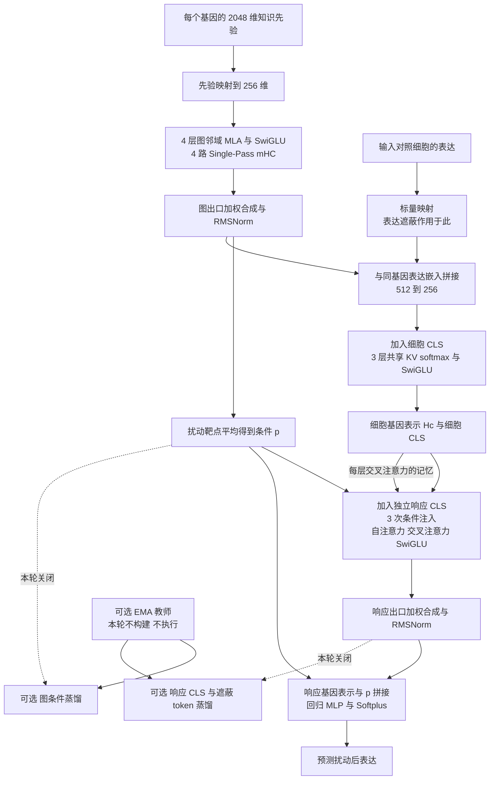

# GraD-Pert 小模型完整架构设计与公式教材

> 设计版本 `small-softmax-mhc-v2`，2026-11-09。本文记录本轮讨论收敛后的单一组合方案，面向实现与零基础阅读。文档完成不代表模型已实现、训练已启动或效果已验证。
>
> 阅读方式是 **一条公式 → 变量与维度 → 这条公式做什么**。维度以列向量表示，代码可以用行向量存储并相应转置权重。
>
> 最新实验范围：实现全部本轮改动，作为**一组组合消融**，复用已有同协议的 2 epoch 基线，新组完整训练 2 epoch。实现由用户指定的“实验”会话负责，运行监督由“监督”会话负责。本文不授权重跑基线、追加其它消融、DEG 或测试集调参。
>
> **最新覆盖决定：这一轮默认关闭两套蒸馏（图 SSL1、响应 SSL2），仅表达预测损失参与训练。** Teacher、EMA、蒸馏中心和原型头均不构建、不执行。文中蒸馏结构是保留的可选设计，不是本轮启用项；以后开启需要另一个明确配置与实验记录。

## 0. 本文怎样使用

### 0.1 三类内容的边界

1. **讨论确定的结构**：256 维、图 4 层、细胞和响应各 3 层、4 路 mHC、图邻域 softmax MLA、主干共享 KV softmax、稠密 SwiGLU、融合改为拼接投影、原型头瓶颈 RMSNorm。
2. **为使方案可实现而补充的默认值**：第 16 节单独列出初始化、epsilon、bias、dropout 和边来源矩阵参数化。它们是本设计的工程选择，不冒充用户逐项指定或 DS 官方训练配方。
3. **继承但须在启动前绑定的实验协议**：条件划分、数据行列、基线身份、优化器、学习率、视图抽样等。它们从同协议旧运行的封存配置继承，不能用本文的新模型名字覆盖旧 checkpoint 的来源。

本设计参考 DS4.1 的计算结构，但保留表达预测任务和此前确认的图关系机制。它不是 DS4.1 的缩小版语言模型，也不是完整 CSA2 复刻。特别是图注意力的关系分支参考此前讨论的 GLM-5 MLA 路径，主干则参考 DS4.1 的共享 KV 核心。所有原生实现仍属于 GraD-Pert。

### 0.2 为什么另外建一份文档

旧 `docs/design/GRADPERT_V2.md` 含有历史候选值，例如四层细胞编码器、KDA、图和表达相加、早期损失权重。它们不是本轮最终结构。本文件只定义新版本，不修改历史实验、配置或旧设计的原始记录。

本次读取工作区的 HEAD 为 `276d7baac57c6a4130b5e43563cc7eccd8c8ff7e`，工作区已有其它改动，且没有检出 v2 模型文件。本轮对旧原生实现的核对使用本地 Git 对象 `c57c139858fa4b911cbafdeee957736bc33b7497` 的 `model.py` 和 `objective.py`。这是**历史实现参照**，不是新设计源码 SHA，也不是当前工作区已实现新模型的证据。

### 0.3 两份文档

- 项目设计文档：`/Users/elan/code/grad-pert/docs/design/GRADPERT_SMALL_SOFTMAX_MHC_DESIGN_20261109.md`。
- 论文目录教材：`/Users/elan/Documents/论文/GraD-Pert小模型完整架构教材.md`。
- 两份正文保持逐字一致。写法参考用户提供的 `DeepSeek-V4.1-Flash架构教材.md`，数值例子均为教学模拟，不是实验指标。

## 1. 一页看完整流程

主预测路径没有 KDA。图分支在图邻域内做 softmax；细胞与响应主干在当前视图的有效 token 集合内做双向 softmax。预测头不直接读取真实扰动后表达。

| 模块 | 最终路径 |
|---|---|
| GenePT 映射 | RMSNorm(2048) → 2048→1024 → GELU → 1024→256 → GELU → 256→256 |
| 表达映射 | 1→256 → GELU → 256→256 |
| 图和表达融合 | 拼接 256+256 → Linear(512→256) |
| 图注意力 | 4 层，4 头；Q/KV 中间均 128；每头内容 48、关系 16、V 64 |
| 图关系来源 | GO、STRING、expander、self 四位来源 → 非正交 16×16 变换 |
| 图 FFN | 256→1024，拆成 512+512，SwiGLU，512→256 |
| 图出口 | 4 路加权合成 → RMSNorm(256) |
| 扰动条件 | 有效靶点的图出口表示取平均 |
| 细胞主干 | 3 层，每层共享 KV softmax 自注意力 → SwiGLU |
| 响应主干 | 3 层，每层条件注入 → 自注意力 → 交叉注意力 → SwiGLU |
| 主干 Q / KV | Q：256→128→RMSNorm→4×64；KV：256→64→RMSNorm，K=V |
| 主干输出 | 两组各拼接 2×64 → 各自 Linear(128→64) → 拼接128 → Linear(128→256) |
| 残差 | 每个注意力和 FFN 子层使用独立 4 路 Single-Pass mHC |
| 分支出口 | 最后子层留下的读取权重合成四路，再 RMSNorm |
| 表达预测 | 响应基因表示与条件拼接 → 512→256 → GELU → 256→1 → Softplus |
| 可选蒸馏投影，本轮关闭 | 256→2048 → GELU → 2048→256 → RMSNorm / 16 → 无偏置 256→16384 |

## 2. 输入、基因集合与符号

### 2.1 一个训练样本是什么

$$
\mathcal D_b=(x_b^{\mathrm{ctrl}},\ y_b^{\mathrm{pert}},\ P_b,\ Q_b).
$$

**变量**：$b$ 是样本行编号；$x_b^{\mathrm{ctrl}}$ 是按协议抽取的对照细胞表达；$y_b^{\mathrm{pert}}$ 是该行的真实扰动后表达；$P_b$ 是扰动靶点基因集合；$Q_b$ 是这次输入和预测使用的有序基因集合。

**含义**：模型用对照表达和扰动条件预测扰动后表达。对照和扰动细胞是协议配对，不宣称它们是同一个细胞的前后测量。真实扰动后表达只进入监督损失，不能进入预测输入或教师输入。

### 2.2 身份和表达是不同信息

$$
g_i\in\mathbb R^{2048},\qquad x_{b,i}^{\mathrm{ctrl}}\in\mathbb R.
$$

**变量**：$i$ 表示一个明确的基因 ID；$g_i$ 是冻结先验表中该基因的知识向量；$x_{b,i}^{\mathrm{ctrl}}$ 是当前对照细胞中该基因的表达标量。

**含义**：同一个基因在不同细胞中使用同一份知识先验，但表达量可以不同。训练时允许知道一个基因的 ID 和知识，不等于允许读取其被留出的表达值。先验表、表达列、图节点与输出列都必须通过基因 ID 显式对齐。

### 2.3 后面反复出现的符号

| 符号 | 含义 |
|---|---|
| $B$ | 一次有效更新的样本行数，不等同于物理 microbatch |
| $N$ | 当前细胞视图包含的基因数；CLS 额外增加一个 token |
| $G$ | 当前图计算支持集合的节点数，可以大于 $N$ |
| $d=256$ | 每条状态向量的特征数 |
| $r,s=1,\ldots,4$ | 残差流编号，不是注意力头 |
| $h=1,\ldots,4$ | 注意力头编号，不是残差流 |
| $t$ | 子层编号；一个注意力或一个 FFN 各计一个子层 |
| $\ell$ | 完整层编号；图一层有两个子层，响应一层有三个子层 |
| $\operatorname{Concat}$ | 沿特征维拼接；不是数值相加 |
| $\odot$ | 对齐位置的数值逐元素相乘 |
| $\operatorname{sg}$ | stop-gradient，保留数值但不向该路径反向传播 |

## 3. 先读懂 RMSNorm 和激活函数

### 3.1 RMSNorm 沿单个 token 的特征维计算

$$
\operatorname{RMSNorm}_{D}(v)_k
=\gamma_k\frac{v_k}{\sqrt{D^{-1}\sum_{a=1}^{D}v_a^2+\epsilon}}.
$$

**变量**：$v\in\mathbb R^D$ 是一个 token 的向量；$k,a$ 是特征编号；$\gamma_k$ 是可学习的逐维缩放；$\epsilon>0$ 是稳定项。

**含义**：先用整条向量的均方根统一控制尺度，再允许模型调整不同维度的权重。它不减去均值，不跨基因、不跨细胞求统计量。同层各基因共享 $\gamma$，不同模块拥有独立 $\gamma$。本文普通 RMSNorm 均无可学习平移项。

**例子**：忽略 $\epsilon$，$[3,4]$ 的均方根为 $\sqrt{12.5}$；当 $\gamma=[1,1]$ 时，归一化后约为 $[0.849,1.131]$。它的长度不是 1，而是 $\sqrt 2$。

### 3.2 GELU 用在映射 MLP 中

$$
\operatorname{GELU}(z)=z\Phi(z).
$$

**变量**：$z$ 是一个标量特征；$\Phi$ 是标准正态分布的累积分布函数；向量输入逐元素计算。

**含义**：它平滑地调整正负特征的通过程度。GenePT、表达、条件注入及回归 MLP 使用 GELU；不是把整个模型的所有 MLP 都改成 SwiGLU。

### 3.3 SiLU 用在 SwiGLU 的 gate 路径

$$
\operatorname{SiLU}(z)=z\sigma(z),\qquad \sigma(z)=\frac{1}{1+e^{-z}}.
$$

**变量**：$\sigma$ 是 sigmoid，输出 0 到 1；$z$ 是 gate 线性投影的输出。

**含义**：SwiGLU 先对 gate 做 SiLU，再与另一条 up 路径相乘。它不是把 GELU 的名字换成 SiLU，还增加了独立的数据路径。

## 4. GenePT 先验如何进入图

### 4.1 先归一化原始先验

$$
\bar g_i=\operatorname{RMSNorm}_{2048}(g_i).
$$

**变量**：$g_i$ 是冻结的 2048 维先验；$\bar g_i$ 是归一化后的先验。RMSNorm 的缩放和后面的映射可学习，先验原始表不更新。

**含义**：先控制不同基因先验向量的尺度，再映射到模型空间。这不代表每个基因的内容变得相同。

### 4.2 第一层映射

$$
a_i^{(1)}=\operatorname{GELU}(W_1\bar g_i+b_1)\in\mathbb R^{1024}.
$$

**变量**：$W_1\in\mathbb R^{1024\times2048}$；$b_1\in\mathbb R^{1024}$；$a_i^{(1)}$ 是第一层输出。

**含义**：把 2048 个输入特征组合成 1024 个可供本任务使用的特征。

### 4.3 第二层映射

$$
a_i^{(2)}=\operatorname{GELU}(W_2a_i^{(1)}+b_2)\in\mathbb R^{256}.
$$

**变量**：$W_2\in\mathbb R^{256\times1024}$；$b_2\in\mathbb R^{256}$。

**含义**：进一步压缩到模型宽度 256。此处保留 GELU。

### 4.4 最后一层同宽映射

$$
h_i^{G,0}=W_3a_i^{(2)}+b_3\in\mathbb R^{256}.
$$

**变量**：$W_3\in\mathbb R^{256\times256}$；$b_3\in\mathbb R^{256}$；上标 $G,0$ 表示图分支的初始状态。

**含义**：在 256 维空间内重新组合特征，然后交给图编码器。这里没有额外输出 LayerNorm，也没有再增加一层 1024→256。最终链条明确是 **2048→1024→256→256**。

## 5. 所有分支共用的四路 Single-Pass mHC 规则

这是连接规则，不是注意力算子。图、细胞、响应分别有自己的状态和参数，不共用同一组动态权重。其读取/写回顺序以 DS 固定版本为参照 [R1–R2]，下面给出我们的 256 维版本。

### 5.1 进入一个分支时复制四路

$$
X_{i,r}^{(0)}=h_i^{(0)},\quad r=1,2,3,4;
\qquad a_i^{(0)}=(1,0,0,0).
$$

**变量**：$h_i^{(0)}\in\mathbb R^{256}$ 是该分支的初始 token；$X_i^{(0)}\in\mathbb R^{4\times256}$ 是四路状态；$a_i^{(0)}$ 是首个子层读取权重。

**含义**：初始四路相同，第一次只读取第一路，因此不会把输入扩大四倍。四路不是四份不同训练样本。

### 5.2 从当前四路状态生成 24 个系数原始值

$$
\rho_i^{(t)}=
W_t\operatorname{vec}(X_i^{(t-1)})
\left(1024^{-1}\|\operatorname{vec}(X_i^{(t-1)})\|_2^2+\epsilon_N\right)^{-1/2}.
$$

**变量**：$\operatorname{vec}$ 把四路展开成 1024 维；$W_t\in\mathbb R^{24\times1024}$；$\rho_i^{(t)}\in\mathbb R^{24}$；$\epsilon_N$ 是 RMS 稳定项。

**含义**：根据当前 token 的四路内容，决定下一次怎样读、这一次怎样写。这里的 RMS 缩放没有另加逐维 $\gamma$，不要误写为普通带仿射参数的 RMSNorm(1024)。24 来自 $4+4+4\times4$。

### 5.3 四个权重留给下一个子层读取

$$
a_{i,r}^{(t)}=\sigma(\eta_t^a\rho_{i,r}^{(t)}+\beta_{t,r}^a)+\epsilon_H.
$$

**变量**：$\eta_t^a$ 是该子层可学习的一个缩放标量；$\beta_t^a$ 是四维基值；$\epsilon_H$ 是 mHC 稳定项；$a^{(t)}$ 是新产生的读取权重。

**含义**：这些权重供**下一个子层**使用。它们经过 sigmoid，但不要求和为 1；不是 softmax 注意力权重。

### 5.4 四个权重控制本次输出写入多少

$$
c_{i,r}^{(t)}=2\sigma(\eta_t^c\rho_{i,4+r}^{(t)}+\beta_{t,r}^c).
$$

**变量**：$\eta_t^c$ 是写入缩放标量；$\beta_t^c$ 是四维基值；$c_{i,r}^{(t)}$ 在 0 到 2 之间。

**含义**：同一份注意力或 FFN 输出可以以不同强度写入四路。

### 5.5 剩余 16 个数决定旧状态怎样混合

$$
L_i^{(t)}=\operatorname{reshape}_{4\times4}
\left(\eta_t^B\rho_{i,9:24}^{(t)}+\beta_t^B\right).
$$

**变量**：索引按数学的 1 起算，$9:24$ 包含 16 项；$\eta_t^B$ 是缩放标量；$\beta_t^B\in\mathbb R^{16}$；$L_i^{(t)}$ 是混合分数矩阵。代码切片应为 `[8:24]`。

**含义**：矩阵的行表示来源流，列表示目标流。下一步把它变成近似双随机矩阵，控制混合尺度。

### 5.6 Sinkhorn 先作行 softmax，再作列归一化

$$
M^{(0)}=\operatorname{ColumnNorm}
\left(\operatorname{Softmax}_{\mathrm{row}}(L_i^{(t)})+\epsilon_H\right).
$$

**变量**：行 softmax 令每行之和为 1；$\operatorname{ColumnNorm}(A)_{sr}=A_{sr}/(\sum_u A_{ur}+\epsilon_H)$；$M^{(0)}$ 是初步矩阵。

**含义**：先保证元素为正，再约束流入每一目标流的总比例。

### 5.7 再交替归一化 19 次

$$
M^{(k+1)}=\operatorname{ColumnNorm}(\operatorname{RowNorm}(M^{(k)})),
\quad k=0,\ldots,18;\qquad B_i^{(t)}=M^{(19)}.
$$

**变量**：$\operatorname{RowNorm}(A)_{sr}=A_{sr}/(\sum_v A_{sv}+\epsilon_H)$；$B_i^{(t)}$ 是最终 4×4 混合矩阵。

**含义**：连同上一步共对应 20 轮配置。有限迭代及稳定项使行列和只是近似 1，不能声称浮点下精确双随机。

### 5.8 当前子层使用上一次留下的读取权重

$$
u_i^{(t)}=\operatorname{RMSNorm}_{256,t}
\left(\sum_{r=1}^{4}a_{i,r}^{(t-1)}X_{i,r}^{(t-1)}\right).
$$

**变量**：$a^{(t-1)}$ 是传入权重；$u_i^{(t)}$ 是当前子层输入；$\operatorname{RMSNorm}_{256,t}$ 的参数属于当前子层。

**含义**：读取四路、合成一条、再做 Pre-Norm。不要误用刚算出的 $a^{(t)}$ 来读取当前子层，这会变成另一种 mHC 时序。

### 5.9 执行一次注意力或前馈

$$
y_i^{(t)}=F_t(u^{(t)})_i\in\mathbb R^{256}.
$$

**变量**：$F_t$ 是本子层的算子；注意力可以读取其它 token，FFN 则逐 token 运算；$y_i^{(t)}$ 是一份输出。

**含义**：四路只改变读写连接，不要求重复计算四个 $F_t$。

### 5.10 混合旧流并写回输出

$$
X_{i,r}^{(t)}=\sum_{s=1}^{4}B_{i,sr}^{(t)}X_{i,s}^{(t-1)}
+c_{i,r}^{(t)}y_i^{(t)}.
$$

**变量**：$s$ 是来源流，$r$ 是目标流；$B_{i,sr}^{(t)}$ 是旧流混合系数；$c_{i,r}^{(t)}$ 是输出写入系数。

**含义**：一部分信息沿旧状态流动，一部分来自新计算。此处已经完成残差连接，算子内部不能再额外做一次 `input + output`。

### 5.11 分支结束时再合成一次

$$
z_i=\operatorname{RMSNorm}_{256,\mathrm{out}}
\left(\sum_{r=1}^{4}a_{i,r}^{(T)}X_{i,r}^{(T)}\right).
$$

**变量**：$T$ 是该分支最后一个子层编号；$a^{(T)}$ 来自该子层更新前的状态；$X^{(T)}$ 是更新后的四路状态；$z_i$ 是出口表示。

**含义**：用最后留下的读取权重合并更新后的状态，不用四路平均替代。本版图 $T=8$，细胞 $T=6$，响应 $T=9$。条件注入是额外状态更新，不单独计 mHC 子层。

## 6. 四层图邻域 MLA

每层均为 **mHC 读取与 RMSNorm → 图邻域 MLA → mHC 写回 → mHC 读取与 RMSNorm → SwiGLU → mHC 写回**。四层各有独立参数，第一层到第四层使用相同算子类型。下面省略层号；$u_i$ 是本层完成 mHC 读取和 Pre-Norm 的基因状态。

### 6.1 图邻域和边来源

$$
\mathcal N(i)=\{j:\text{冻结图及当前视图允许基因 }i\text{ 读取 }j\},
\qquad e_{ij}\in\{0,1\}^{4}.
$$

**变量**：$i$ 是查询基因；$j$ 是邻居基因；$\mathcal N(i)$ 是入邻居集合；$e_{ij}$ 的四项依次为 GO、STRING、expander、自环来源。

**含义**：一条边可以同时具有多个来源，所以使用 multi-hot，而非强制 one-hot。同一对基因重复边应合并来源，避免无意重复计权。保留自环保证每行至少一个有效邻居。expander 是结构增强，不标成生物证据。

### 6.2 Q 压到 128 维

$$
c_i^Q=\operatorname{RMSNorm}_{128}(W_{DQ}u_i).
$$

**变量**：$W_{DQ}\in\mathbb R^{128\times256}$；$c_i^Q\in\mathbb R^{128}$ 是查询潜变量。

**含义**：内容查询和关系查询都从这条压缩路径产生，对齐前面确认的 Q 来源。

### 6.3 邻居 KV 独立压到 128 维

$$
c_j^{KV}=\operatorname{RMSNorm}_{128}(W_{DKV}u_j).
$$

**变量**：$W_{DKV}\in\mathbb R^{128\times256}$，与 $W_{DQ}$ 不共享；$c_j^{KV}$ 是邻居的共享潜变量。

**含义**：所有图注意力头的内容 K 和 V 从同一条压缩记忆展开。但图中的 K、V 是不同映射，不等于后面主干的 K=V。

### 6.4 生成内容 Q

$$
q_{ih}^{C}=W_{QC,h}c_i^Q\in\mathbb R^{48}.
$$

**变量**：$W_{QC,h}\in\mathbb R^{48\times128}$；$h$ 是四个头之一；$C$ 表示内容。

**含义**：每个头有自己的内容查询。128 是共享中间宽度，48 才是每头内容点积的维度。

### 6.5 生成内容 K

$$
k_{jh}^{C}=W_{KC,h}c_j^{KV}\in\mathbb R^{48}.
$$

**变量**：$W_{KC,h}\in\mathbb R^{48\times128}$；$k_{jh}^{C}$ 是邻居 $j$ 在头 $h$ 的内容键。

**含义**：用来判断该邻居的内容与当前查询是否匹配。

### 6.6 生成 V

$$
v_{jh}=W_{V,h}c_j^{KV}\in\mathbb R^{64}.
$$

**变量**：$W_{V,h}\in\mathbb R^{64\times128}$；$v_{jh}$ 是该邻居真正被汇总的信息。

**含义**：K 回答“匹配吗”，V 提供“读到什么”。关系分支控制读取分数，不额外向 V 拼接来源码。

### 6.7 从边来源构造变换矩阵

$$
E_{ij}=I_{16}+\sum_{a=1}^{4}e_{ij,a}A_a\in\mathbb R^{16\times16}.
$$

**变量**：$I_{16}$ 是单位矩阵；$A_a$ 是第 $a$ 种来源的可学习矩阵；同一层四个头共享这四个矩阵，不同图层独立。

**含义**：这是为前面确认的“来源生成变换后乘向量”补充的具体参数化。本版选用线性 multi-hot 组合，既支持多来源也避免额外大 MLP。$E$ 是一般非正交矩阵，不生成角度，不称为 RoPE。

### 6.8 关系 Q 来自压缩后的查询

$$
q_{ijh}^{R}=E_{ij}W_{QR,h}c_i^Q\in\mathbb R^{16}.
$$

**变量**：$W_{QR,h}\in\mathbb R^{16\times128}$；$R$ 在本设计中表示 relation；额外的 $j$ 下标说明结果依赖当前这条边。

**含义**：先从压缩查询生成关系向量，再施加该边的来源变换。不能改成从未压缩 $u_i$ 直接生成而仍声称与已讨论路径相同。

### 6.9 关系 K 来自未压缩的邻居

$$
k_{ij}^{R}=E_{ij}W_{KR}u_j\in\mathbb R^{16}.
$$

**变量**：$W_{KR}\in\mathbb R^{16\times256}$；关系 K 在所有头之间共享；$u_j$ 是 256 维归一化邻居状态，而不是 $c_j^{KV}$。

**含义**：这保留了用户强调的非对称来源——**关系 Q 来自压缩的 Q，关系 K 来自未压缩输入**。边来源矩阵参与两边的乘法，不是把来源向量简单 concat 到输入。

### 6.10 拼成每头的完整 Q、K

$$
q_{ijh}=\operatorname{Concat}(q_{ih}^{C},q_{ijh}^{R}),
\qquad k_{ijh}=\operatorname{Concat}(k_{jh}^{C},k_{ij}^{R})\in\mathbb R^{64}.
$$

**变量**：每个完整向量由 48 维内容和 16 维关系组成。concat 表示按特征拼接，不是两向量相乘。

**含义**：完整 Q/K 点积自动等于“内容点积＋关系点积”，没有遗漏交互项，因为两个分量占据不同坐标。

### 6.11 只在图邻居上打分

$$
s_{ijh}=\frac{q_{ijh}^{\mathsf T}k_{ijh}}{8},\qquad j\in\mathcal N(i).
$$

**变量**：$s_{ijh}$ 是未归一化分数；$8=\sqrt{48+16}$。

**含义**：48＋16 总共 64 个乘积相加，所以按 $\sqrt{64}$ 缩放。图外节点不参与 softmax。这里不叠加旧来源 key gate 或旧来源偏置，以免同一来源作用被悄悄重复保留。

### 6.12 为什么相同 E 不会自动抵消

$$
(E_{ij}q_0)^\mathsf T(E_{ij}k_0)=q_0^\mathsf T E_{ij}^{\mathsf T}E_{ij}k_0.
$$

**变量**：$q_0=W_{QR,h}c_i^Q$，$k_0=W_{KR}u_j$；$E^\mathsf TE$ 是由该来源组合决定的半正定度量。

**含义**：如果误把 $E$ 约束为同一个正交旋转，则 $E^\mathsf TE=I$，来源影响会消失。本设计明确不施加正交约束。这也意味着关系作用受半正定度量形式约束，不等价于任意有向关系双线性打分；方向由查询/记忆投影和图方向共同表达。

### 6.13 softmax 变成读取比例

$$
\alpha_{ijh}=\frac{\exp(s_{ijh})}{\sum_{j'\in\mathcal N(i)}\exp(s_{ij'h})}.
$$

**变量**：$j'$ 枚举同一查询的有效邻居；$\alpha_{ijh}$ 是头 $h$ 分给邻居 $j$ 的权重。

**含义**：每头的图邻居权重和为 1。本图方案没有新增主干的 sink；自环保证合法非空支持。

### 6.14 汇总四个头并输出

$$
o_i^G=W_O^G\operatorname{Concat}_{h=1}^{4}
\left(\sum_{j\in\mathcal N(i)}\alpha_{ijh}v_{jh}\right)\in\mathbb R^{256}.
$$

**变量**：每个头汇总得到 64 维；$W_O^G\in\mathbb R^{256\times256}$。

**含义**：这是第 5.9 节的注意力 $F_t$ 输出，随后由 mHC 写回。整层再执行第 7 节的 FFN。重复四层后按第 5.11 节得到每个基因的图出口 $z_i^G$。

**实现要求**：邻居的 $u_j$ 必须由同一层的旧状态同步产生，不能在按行分块时原地更新记忆，使后面的查询读到“新旧混合”的节点。静态图结果只有在模型版本、视图和 mask 完全相同时才可复用；跨 optimizer update 不能把旧图输出当成新输出。

## 7. 图、细胞和响应共用的稠密 SwiGLU 形式（v2 保留官方裁剪）

### 7.1 一次投影得到两条路径

$$
[g_i;v_i]=W_{\mathrm{in}}u_i\in\mathbb R^{1024}.
$$

**变量**：$u_i\in\mathbb R^{256}$ 已经过本 FFN 独立的 Pre-RMSNorm；$W_{\mathrm{in}}\in\mathbb R^{1024\times256}$；$g_i,v_i$ 各 512 维。方括号里的分号仅表示拼接。

**含义**：1024 是两个分支合计的宽度。不是 gate 和 up 各 1024，更不是之前被用户改掉的总宽度 2048。

### 7.2 用 gate 调节 up 路径

$$
w_i=\operatorname{SiLU}(\min(g_i,10))\odot\operatorname{clip}(v_i,-10,10)\in\mathbb R^{512}.
$$

**变量**：$g_i$ 是 gate；$v_i$ 是 up；$w_i$ 是逐维门控后的特征。

**含义**：不是选择专家，而是对当前 token 的 512 个中间特征作连续调节。所有 token 都经过同一个本层 FFN。

### 7.3 降回模型宽度

$$
f_i=W_{\mathrm{out}}w_i\in\mathbb R^{256}.
$$

**变量**：$W_{\mathrm{out}}\in\mathbb R^{256\times512}$；$f_i$ 交给 mHC 写回。

**含义**：新特征重新回到每条状态的 256 维。两组矩阵无 bias，合计 $256\times1024+512\times256=393216$ 个权重，不含入口 Norm 和 mHC。图的 4 个 FFN、细胞的 3 个 FFN、响应的 3 个 FFN 均不共享参数。根据最新对齐要求，保留冻结官方 Flash 配置 `swiglu_limit=10`：gate 在 FP32 仅作上限10截断，up 在 FP32 作[-10,10]截断，执行 SiLU(gate)×up 后转回分支激活类型再输出投影。实现可将拼接矩阵存为两份独立 Linear256→512，参数量和函数相同。不加入 MoE 路由。

## 8. 扰动条件、表达映射与融合

### 8.1 多靶点合成一条扰动条件

$$
p_b=\frac{1}{|P_b|}\sum_{i\in P_b}z_i^G\in\mathbb R^{256}.
$$

**变量**：$P_b$ 是该行有效扰动靶点；$z_i^G$ 是归一化后的图出口；$p_b$ 是条件向量。

**含义**：一个靶点直接取其表示；多个靶点取平均。平均后不保证 RMS 仍为 1，本版不额外给 $p_b$ 加一个 Norm。没有有效靶点时应拒绝输入；若某协议需要 control/no-perturbation 条件，须单独声明其表示，不能拿空集合平均。靶点可以不在本次表达 query 中，但必须存在于图支持和 ID 映射中。

### 8.2 一个表达标量升到 256 维

$$
a_{b,i}=W_{e2}\operatorname{GELU}(W_{e1}x_{b,i}^{\mathrm{ctrl}}+b_{e1})+b_{e2}.
$$

**变量**：$W_{e1}\in\mathbb R^{256\times1}$，$b_{e1}\in\mathbb R^{256}$；$W_{e2}\in\mathbb R^{256\times256}$，$b_{e2}\in\mathbb R^{256}$；$a_{b,i}\in\mathbb R^{256}$。

**含义**：把表达量变为模型可处理的特征。该小 MLP 在所有基因和细胞之间共享，基因身份由图向量提供。两层之间是 GELU，出口不额外做 LayerNorm。

### 8.3 Student 表达遮蔽发生在融合之前

$$
\tilde a_{b,i}=\begin{cases}m_{\mathrm{expr}},&i\in M_b,\\a_{b,i},&i\notin M_b.\end{cases}
$$

**变量**：$M_b$ 是本视图的遮蔽基因集合；$m_{\mathrm{expr}}\in\mathbb R^{256}$ 是可学习遮蔽向量。

**含义**：只替换表达嵌入，基因身份仍保留。Teacher 在匹配的有效基因集合上读取未遮蔽对照表达。Student 的 cell memory、CLS 和 response 都必须从遮蔽后的输入重新计算，不能借用未遮蔽的表达缓存。表达零值是合法数据，不是 padding。

### 8.4 图与表达拼接后融合

$$
h_{b,i}^{C,0}=W_F\operatorname{Concat}(z_i^G,\tilde a_{b,i})+b_F\in\mathbb R^{256}.
$$

**变量**：$W_F\in\mathbb R^{256\times512}$，$b_F\in\mathbb R^{256}$；$C$ 表示 cell 分支。

**含义**：先让模型分别看到知识和表达的 256 个坐标，再学习怎样混合。这里明确替代旧版的逐元素相加，不再额外做两者相加，也不在投影后追加 GELU 或 Norm。

### 8.5 加入独立可学习 CLS

$$
H_b^{C,0}=\operatorname{Stack}(h_{b,1}^{C,0},\ldots,h_{b,N}^{C,0},c_C),
\qquad c_C,c_R\sim\mathcal N(0,0.02^2I_{256}).
$$

**变量**：$c_C$ 是细胞 CLS 参数，$c_R$ 是独立响应 CLS 参数；二者各 256 维；$H_b^{C,0}\in\mathbb R^{(N+1)\times256}$。

**含义**：初始化时随机采样一次，随后作为模型参数训练；不是每个 batch 重采样。相同 CLS 参数扩展给各细胞后，通过各自输入计算出不同 CLS 表示。CLS 不对应任何真实基因，不能与基因输出错位。

## 9. 主干共享 KV softmax 注意力

本节替换细胞和响应各层的原 KDA/末端 MLA。三层统一使用同一种算子。它保留 DS4.1 共享 KV 和 sink 核心，去掉压缩稀疏索引、跨层缓存复用和分组低秩输出。图分支第 6 节的 MLA 仍单独存在。

### 9.1 生成压缩查询

$$
c_i^Q=\operatorname{RMSNorm}_{128}(W_{DQ}u_i).
$$

**变量**：$u_i\in\mathbb R^{256}$ 是当前注意力的 mHC/Pre-Norm 输出；$W_{DQ}\in\mathbb R^{128\times256}$；参数与图注意力完全独立。

**含义**：保留一个 128 维共享查询中间层。本设计用 128 是前面讨论的项目尺度，不声称严格按 DS 宽度比例缩放。

### 9.2 展开四个查询头

$$
q_{ih}=W_{UQ,h}c_i^Q\in\mathbb R^{64}.
$$

**变量**：$W_{UQ,h}\in\mathbb R^{64\times128}$；四个头可以合并为一个 128→256 的投影。

**含义**：每个头独立提出查询；投影之后不再作每头 L2 归一化。

### 9.3 一条共享 KV

$$
z_j=\operatorname{RMSNorm}_{64}(W_{KV}m_j),\qquad k_{jh}=v_{jh}=z_j.
$$

**变量**：$m_j\in\mathbb R^{256}$ 是记忆侧状态；$W_{KV}\in\mathbb R^{64\times256}$；$z_j\in\mathbb R^{64}$ 被所有头共享。

**含义**：同一个向量用于匹配和汇总，没有两套分别学习的 K、V 上投影。自注意力中 $m_j=u_j$；交叉注意力中 $m_j$ 是已做出口 RMSNorm 的细胞基因表示，因此不重复加一次 256 维 Norm，投影后的 64 维 Norm 保留。

### 9.4 用点积匹配

$$
s_{ijh}=q_{ih}^{\mathsf T}z_j/8,\qquad j\in\mathcal M_i.
$$

**变量**：$\mathcal M_i$ 是有效记忆集合；每头 64 维，所以除以 8；$s$ 是分数。

**含义**：细胞/响应自注意力可读取本视图的全部有效基因和自己的 CLS，交叉注意力读取细胞基因记忆。交叉记忆**不额外附加 control CLS**，与核对过的预测数据流一致。padding 和不允许的输入不参与。

### 9.5 加入每头一个 sink

$$
\alpha_{ijh}=\frac{\exp(s_{ijh})}{\exp(b_h)+\sum_{j'\in\mathcal M_i}\exp(s_{ij'h})}.
$$

**变量**：$b_h$ 是本注意力模块第 $h$ 个头的可学习标量；四个头共四个参数；sink 的 value 为零。

**含义**：当没有值得读取的记忆时，一部分权重可以流向零输出。真实 token 的权重和因此可以小于 1。$b_h$ 是直接加入 softmax 分母的 logit，不再除以 8。[R2]

### 9.6 汇总同一份 KV

$$
y_{ih}=\sum_{j\in\mathcal M_i}\alpha_{ijh}z_j\in\mathbb R^{64}.
$$

**变量**：$y_{ih}$ 是头 $h$ 的输出；每个头的权重不同，虽然共享 $z_j$，输出并不必相同。

**含义**：不同问题可以从同一份记忆中读出不同内容。

### 9.7 分组低秩输出投影（v2 修订）

$$
z_{i1}=W_{O1}\operatorname{Concat}(y_{i1},y_{i2}),\qquad
z_{i2}=W_{O2}\operatorname{Concat}(y_{i3},y_{i4}),\qquad
o_i=W_{OB}\operatorname{Concat}(z_{i1},z_{i2}).
$$

**变量**：两组独立的 $W_{O1},W_{O2}\in\mathbb R^{64\times128}$；$W_{OB}\in\mathbb R^{256\times128}$；全部无 bias。每组仅读取其自己的两个头，输出低秩通道总计128。

**含义**：根据用户“所有实现细节对齐 DS v4.1”的最新要求，采用冻结官方 `Attention.wo_a/wo_b` 的分组块对角投影结构，取适合本模型的两组、每组 rank64。输出投影后无额外激活和 Norm。此前 v1 单 Linear256→256 的设定被本节替代，未用于正式运行。

### 9.8 一个两条记忆的模拟例子

$$
s_1=\ln 2,\quad s_2=0,\quad b=0
\quad\Longrightarrow\quad (\alpha_1,\alpha_2,\alpha_{\mathrm{sink}})=(1/2,1/4,1/4).
$$

**变量**：$s_1,s_2$ 是两个有效记忆的分数；$b$ 是 sink 分数；三者指数为 2、1、1。

**含义**：若只展示 V 的两个坐标 $z_1=[2,0]$、$z_2=[0,4]$，汇总为 $[1,1]$，不是 $[4/3,4/3]$。后者是取消 sink 后的结果，所以普通 softmax 内核不能不经核验就当作带 sink 版本。

### 9.9 基因任务对位置的适配

本主干不对数组序号施加文本 RoPE，不作因果遮罩，不按序号划滑动窗口。因此它不具备 DS 的位置旋转与输出逆旋转路径；这是真实任务差异，不是“完全相同”的实现。图中的关系 $E_{ij}$ 也不进入主干或充当主干 RoPE。

给定同一个输入基因集合，同步重排基因 ID、表达、mask 和输出索引，主干应在数值误差范围内得到重排后的相同基因输出，CLS 应保持不变。改变输入基因集合则会改变上下文，不能要求同样结果。图边在 ID 映射下的重排也应等变。

完整 softmax 对有效长度 $N$ 的主要打分工作量为二次增长。推荐分块/融合实现以减少物化显存，但它不把数学复杂度变为线性。Flash 风格实现必须显式验证 sink 和反向梯度。

## 10. 细胞和响应分支怎样串起来

### 10.1 细胞分支入口

$$
H_b^{C,0}=[z_{b,1},\ldots,z_{b,N},c_{\mathrm{cell}}].
$$

**变量**：$z_{b,i}\in\mathbb R^{256}$ 是第 8 节的图与表达融合结果；$c_{\mathrm{cell}}$ 是可学习的细胞 CLS；$H_b^{C,0}$ 共 $N+1$ 个 token。这里方括号沿 token 轴排列，不是把特征拼成一个大向量。

**含义**：CLS 作为一个额外成员参加细胞自注意力，不是先对基因取平均得到的常数。每个 token 复制为四路，初始读取权重取第 5 节的 one-hot。

### 10.2 一个细胞层

$$
(X^{C,\ell,\mathrm{att}},a^{C,\ell,\mathrm{att}})
=\operatorname{HC}_{C,\ell,\mathrm{att}}(X^{C,\ell-1},a^{C,\ell-1};\operatorname{SharedKVSelfAttention}).
$$

**变量**：$\ell=1,2,3$；$X$ 保存每个 token 的四路状态；$a$ 保存供下一子层读取的四个权重；$\operatorname{HC}$ 就是第 5 节的完整 Single-Pass 算法，包含入口 RMSNorm；注意力函数是第 9 节。

**含义**：先让每个基因和 CLS 读取当前视图的所有有效 token。不能在 HC 外重复加一次相同入口 Norm。

$$
(X^{C,\ell},a^{C,\ell})
=\operatorname{HC}_{C,\ell,\mathrm{ffn}}(X^{C,\ell,\mathrm{att}},a^{C,\ell,\mathrm{att}};\operatorname{SwiGLU}_{\ell}).
$$

**变量**：$\operatorname{SwiGLU}_{\ell}$ 是第 7 节的 256→1024→拆分→512→256 网络；它的参数与注意力和其它层不共享。

**含义**：每个 token 独立加工刚融合的信息。三层共六个 HC 子层，不是六条残差流。

### 10.3 细胞出口

$$
H_{b,i}^{C}=\operatorname{RMSNorm}_{256}\!\left(\sum_{r=1}^{4}a_{b,i,r}^{C,3}X_{b,i,r}^{C,3}\right).
$$

**变量**：$i$ 可以是一个基因或细胞 CLS；右侧是最后 FFN 写回后的四路状态，权重是最后 FFN 产生的权重；所有 token 共用该分支的出口 Norm 参数。

**含义**：四路重新合成为一条 256 维表示。基因部分成为对照细胞记忆；细胞 CLS 可以用于表示诊断，本轮没有单独的 CLS 损失。

### 10.4 响应入口从哪里来

$$
H_b^{R,0}=[H_{b,1}^{C},\ldots,H_{b,N}^{C},c_{\mathrm{response}}].
$$

**变量**：$c_{\mathrm{response}}$ 是与细胞 CLS 参数独立的可学习 token；$H_{b,i}^{C}$ 是细胞分支刚计算的基因输出。

**含义**：响应分支从对照细胞状态出发，再注入扰动。不是重新从原始表达开始，也不是把细胞 CLS 直接作为响应 CLS。重新复制为四路，并初始化自己的读取权重；细胞分支和响应分支不共享 HC 状态。

### 10.5 每层开始时注入扰动条件

$$
v_{b,i,r}^{\ell}=\operatorname{RMSNorm}_{512}\!\left(\operatorname{Concat}(X_{b,i,r}^{R,\ell-1},p_b)\right).
$$

**变量**：$p_b\in\mathbb R^{256}$ 是第 8 节扰动靶点图表示的平均；$i$ 包括响应 CLS；$r$ 是四路之一；拼接得到 512 维。每层一套条件注入参数，在该层所有 token 和四路之间共享。

**含义**：让当前细胞状态与扰动条件共同决定本层的条件更新。RMSNorm 沿每次拼接的 512 个特征计算，不沿基因集合计算。

$$
\widetilde X_{b,i,r}^{\ell}=X_{b,i,r}^{R,\ell-1}
+W_{2,\ell}\operatorname{GELU}(W_{1,\ell}v_{b,i,r}^{\ell}+b_{1,\ell})+b_{2,\ell}.
$$

**变量**：$W_{1,\ell}\in\mathbb R^{256\times512}$，$W_{2,\ell}\in\mathbb R^{256\times256}$，两个 bias 均为 256 维；$\widetilde X$ 是注入后的状态。

**含义**：采用 512→256→GELU→256，再加回原状态。这个任务专用模块没有 DS 语言主干中的一一对应组件；不应为了“对齐”而捏造官方条件注入层。它不另建一个 HC 路由器，保留当前读取权重，由随后自注意力 HC 读取更新后的状态。

### 10.6 响应每层依次做三件事

$$
(X^{R,\ell,1},a^{R,\ell,1})=\operatorname{HC}_{R,\ell,\mathrm{self}}(\widetilde X^{\ell},a^{R,\ell-1};\operatorname{SharedKVSelfAttention}).
$$

**变量**：第一子层读当前响应基因和响应 CLS；每个查询的可见集合是当前有效响应 token 集合。

**含义**：在已注入扰动的细胞内部交换信息。

$$
(X^{R,\ell,2},a^{R,\ell,2})=\operatorname{HC}_{R,\ell,\mathrm{cross}}(X^{R,\ell,1},a^{R,\ell,1};\operatorname{SharedKVCrossAttention}(H_b^C[1:N])).
$$

**变量**：查询来自 HC 合成的响应状态；记忆 $H_b^C[1:N]$ 只有细胞基因 token，不包含细胞 CLS；交叉注意力使用自己的 Q、KV、输出投影和 sink。

**含义**：响应可以回看原始细胞背景。三层读取同一份细胞分支输出，而不是上一层响应的副本；本轮训练不 detach 细胞记忆，表达损失可以经交叉注意力回传到细胞编码器。

$$
(X^{R,\ell},a^{R,\ell})=\operatorname{HC}_{R,\ell,\mathrm{ffn}}(X^{R,\ell,2},a^{R,\ell,2};\operatorname{SwiGLU}_{R,\ell}).
$$

**变量**：第三子层为该层独立的稠密 SwiGLU；$\ell=1,2,3$。

**含义**：处理响应特征。三次条件注入不计入九个注意力/FFN HC 子层。

### 10.7 响应出口

$$
H_{b,i}^{R}=\operatorname{RMSNorm}_{256}\!\left(\sum_{r=1}^{4}a_{b,i,r}^{R,3}X_{b,i,r}^{R,3}\right).
$$

**变量**：$H_{b,i}^{R}$ 是最终响应基因表示；$i=\mathrm{CLS}$ 时是响应细胞级表示；出口 Norm 独立于细胞和图出口。

**含义**：与图、细胞分支采用同一出口规则，不再简单平均四路。

## 11. 表达预测头

### 11.1 拼接响应与扰动条件

$$
r_{b,i}=\operatorname{Concat}(H_{b,i}^{R},p_b)\in\mathbb R^{512}.
$$

**变量**：$H_{b,i}^{R}$ 描述这个基因的响应状态；$p_b$ 描述当前施加的扰动；预测不使用响应 CLS 代替每个基因的表示。

**含义**：预测头再次明确看到条件。两部分都已有各自分支的出口归一化，拼接后不额外加 Norm。

### 11.2 输出一个标量

$$
s_{b,i}=w_2^\mathsf T\operatorname{GELU}(W_1r_{b,i}+b_1)+b_2.
$$

**变量**：$W_1\in\mathbb R^{256\times512}$，$b_1,w_2\in\mathbb R^{256}$，$b_2\in\mathbb R$；$s_{b,i}$ 是未约束的标量。

**含义**：512→256→GELU→1。这个回归头不是 Transformer 的 FFN，保持小 GELU MLP，不强行替换为 SwiGLU。上文“主干 FFN 全换 SwiGLU”不包括输入映射、条件注入和回归头。

$$
\widehat y_{b,i}=\operatorname{Softplus}(s_{b,i})=\log(1+\exp(s_{b,i})).
$$

**变量**：$\widehat y_{b,i}$ 是扰动后的预测表达，位于冻结数据预处理所定义的非负表达尺度；实际用数值稳定的 Softplus 实现。

**含义**：直接预测表达。不是先预测变化再加回对照。若为了展示变化，另计算 $\widehat\Delta_{b,i}=\widehat y_{b,i}-x_{b,i}^{\mathrm{ctrl}}$；这个派生量不改变前向公式。

## 12. 可选蒸馏头：记录设计，但本轮关闭

用户先前决定将投影瓶颈的 L2 归一化改为 RMSNorm。本节保留接口以便以后使用；**本轮不实例化教师与蒸馏头，不加入优化器，不执行下列公式**。不能仅把已经计算出来的蒸馏损失乘零，继续承担其前向和状态更新成本。

### 12.1 投影到瓶颈

$$
b(v)=W_b\operatorname{GELU}(W_av+b_a)+b_b\in\mathbb R^{256}.
$$

**变量**：$v\in\mathbb R^{256}$ 可为图条件、响应 CLS 或响应基因；$W_a\in\mathbb R^{2048\times256}$，$W_b\in\mathbb R^{256\times2048}$。不同任务的头参数独立。

**含义**：256→2048→GELU→256。该结构是 GraD-Pert 自蒸馏的可选模块，不是 DS 的词表输出头。

### 12.2 用 RMSNorm 替代瓶颈 L2

$$
\bar b(v)=\frac{\operatorname{RMSNorm}_{256}(b(v))}{\sqrt{256}}=\frac{\operatorname{RMSNorm}_{256}(b(v))}{16}.
$$

**变量**：分母 16 是特征数平方根，不是注意力打分的缩放；Norm 的 $\gamma$ 可学习。

**含义**：当 $\gamma=1$ 且忽略 epsilon 时，这个向量的尺度与单位 L2 向量一致。去掉 /16 会使同样原型权重下的 logits 约放大 16 倍，不能称为只换归一化而不改变温度。即使保留 /16，训练后的逐维 $\gamma$ 也会改变方向与尺度，不保证与 L2 数值等价。

### 12.3 原型打分

$$
l(v)=W_p\bar b(v)\in\mathbb R^{16384}.
$$

**变量**：$W_p\in\mathbb R^{16384\times256}$，无 bias；16384 是原型数量，不是基因数量。

**含义**：得到用于软目标匹配的原型分数。保留历史原型层参数化；实现时须查其权重归一化约定，不用任意新参数化替代冻结的旧协议。

### 12.4 若以后开启，教师和学生如何形成目标

$$
p_{T,k}=\operatorname{Softmax}_k((l_T-c)/\tau_T),\qquad
p_{S,k}=\operatorname{Softmax}_k(l_S/\tau_S).
$$

**变量**：$l_T,l_S$ 为教师和学生的原型分数；$c$ 为该头独立的中心；$\tau_T,\tau_S$ 为温度；$k$ 是原型编号。历史实现的温度是 0.04 和 0.1，未来启用须从对应冻结配置确认。

**含义**：教师生成不参与反向传播的软标签，学生学习匹配它。教师和中心只在成功参数更新后提交 EMA；失败步骤不改变其状态。本轮这些对象和更新均不存在。

$$
L_{\mathrm{CE}}=-\sum_{k=1}^{16384}\operatorname{stopgrad}(p_{T,k})\log p_{S,k}.
$$

**变量**：$\operatorname{stopgrad}$ 表示教师概率不回传梯度；$L_{\mathrm{CE}}$ 是一对有效视图/对象的交叉熵。

**含义**：未来恢复图蒸馏时输入图条件表示；恢复响应蒸馏时包含响应 CLS 和遮蔽基因两类对象。视图配对、基因 ID 对齐和平均分母都必须保留真实支持，不能把所有对象混在一起平均。本轮没有蒸馏分数，记录 `disabled`，而非伪造已经测得的零交叉熵。

## 13. 本轮训练目标：只有表达预测

### 13.1 每条样本的误差

$$
L_b=\frac{1}{|\Omega_b|}\sum_{i\in\Omega_b}(\widehat y_{b,i}-y_{b,i}^{\mathrm{pert}})^2.
$$

**变量**：$\Omega_b$ 是该样本合法且确有目标的预测基因集合；$|\Omega_b|$ 是实际有效数量；$y^{\mathrm{pert}}$ 只在这里被读取。

**含义**：先对一条样本的基因误差取平均。不能把缺失列补零变成训练目标，空集合必须在数据协议中明确排除或报错。

### 13.2 有效批次的目标

$$
L_{\mathrm{train}}=L_{\mathrm{prediction}}=\frac{1}{B}\sum_{b=1}^{B}L_b,
\qquad \lambda_{\mathrm{SSL1}}=\lambda_{\mathrm{SSL2}}=0.
$$

**变量**：$B$ 为此次成功优化更新实际包含的样本行数；末批可能小于 320。两个 $\lambda$ 是配置上的关停权重。

**含义**：只用均方误差。它与旧基线的约 29 的联合损失不是同一种统计量，不能直接比较“总 loss 下降了多少”。跨模型只比较同一尺度、同一支持集合的预测 MSE，并单列旧基线含蒸馏、本轮不含蒸馏。

### 13.3 关闭必须落实到运行路径

新实验配置应有明确的两套 enable 开关均为 false，并将权重同时设为零。加载旧配置时允许旧任务继续用原行为；本轮不得隐式回退到旧默认开启状态。

本轮不构建 teacher copy，不构建三个蒸馏 prototype head，不构建 centers，不采样蒸馏专用额外全局/局部视图，不计算图条件 CE、响应 CLS CE 或 masked-token CE，不更新 EMA。图节点、spread、KoLeo 也保持关闭。

**预测路径仍按基线的预测采样协议取输入与目标**：关闭蒸馏专用视图不能顺带把预测输入基因数、预测 mask、图边增强、查询顺序或对照配对改掉。应把预测和蒸馏 RNG 分开，避免删除教师初始化或蒸馏抽样后意外改变预测的数据顺序。新模型维度不同，不承诺与旧模型参数初始化或随机消耗逐位相同。

## 14. 一次训练与一次预测

### 14.1 训练顺序

1. 读取已授权的有序样本行、对照配对、基因轴和扰动条件；不读取任何留出表达来构建输入。
2. 用冻结知识先验计算图表示；图参数是可训练的，不能把旧图结果缓存跨过参数更新。
3. 汇总扰动靶点得到条件；将对照表达映射后与图表示拼接融合。
4. 计算细胞 3 层，再计算响应 3 层，输出每个基因的表达预测。
5. 只计算第 13 节预测损失，按实际样本数加权累积梯度，最后一个 microbatch 不能错误按满批缩放。
6. 检查 loss、梯度和参数有限；按冻结优化器/学习率协议执行一次更新，记录成功更新数。无教师或中心提交动作。
7. 每个完整 epoch 结束保存原生记录；本轮 2 epoch 必须覆盖冻结训练选择中的两遍数据，不用“达到 300”替代完整遍历证明。

### 14.2 推理路径

$$
\widehat y=f_\theta(x^{\mathrm{ctrl}},P;g,\mathcal E).
$$

**变量**：$\theta$ 为新模型训练后的参数；$g$ 为冻结先验；$\mathcal E$ 为冻结合法图边；$P$ 为扰动靶点。

**含义**：预测依赖对照表达、扰动和知识图，不需要真实扰动表达、teacher、蒸馏中心或原型头。评估使用冻结的完整输入/控制抽样，不在结果出来后调整模型或超参数。

## 15. 对齐 DS 的部分和任务适配的部分

| 模块 | 参考结构 | 本设计 |
|---|---|---|
| 归一化 | 注意力/FFN 入口 RMSNorm，最终 Norm | 同样采用 Pre-Norm 与最终 Norm；多路状态先按上一子层权重合成 |
| mHC | 四路 Single-Pass；当前输出给下个子层的读取权重；双随机混合 | 四路、20 次规范化；图 8、细胞 6、响应 9 个子层，独立参数 |
| 主干 Q | 压缩 Q → RMSNorm → 各头展开 | 256→128→RMSNorm→4×64 |
| 主干 KV | 共享潜变量同时作为 K 与 V | 256→64→RMSNorm，所有头共用 K=V |
| 主干 softmax | 内容打分、有效记忆与 attention sink | 保留 sink 与其分母；基因集合双向可见，无伪造文本位置 |
| 主干位置 | DS 文本路径有 RoPE、V 旋转及输出逆旋转 | 无自然文本序号，整体省去这组位置路径；不是只删输出逆旋转 |
| 主干输出 | 大模型分组低秩输出投影 | 小模型直接 4×64→256；显式省去额外瓶颈 |
| 图注意力 | 此前确认的 GLM-5 式压缩 Q、共享 KV 潜变量、独立关系 K | 图限定邻域，Q/KV 均 128；关系 K 来自未压缩输入，关系 Q 来自压缩 Q |
| 图关系 | 本任务边来源，不是语言模型位置 | 16 维关系变换与 48 维内容拼接；无旋转角度 |
| FFN | DS 专家和视觉网络均包含门控 SiLU 路径 | 稠密 SwiGLU 总投影 1024，512+512；无 MoE 路由与专家 |
| 长上下文系统 | CSA2、压缩记忆、索引器、滑窗、跨层缓存等 | 本轮不引入这些大上下文系统，不声称完整 CSA2 对齐 |
| 输入与任务头 | 视觉/语言各有专用映射、输出头 | GenePT、表达、条件注入、回归和可选蒸馏按任务定义 |
| 精度工程 | 大参数低精度量化与激活截断 | 基线兼容 BF16；不用 FP8/FP4 专家或新增截断 |

因此，“细节对齐”具体指本文有源可查的算子与时序，不能把有意省略的内容伪称已经实现；也不能因为文档引用 DS 就引入其运行时依赖。所有原生模块独立实现，保留出处和许可证边界。

## 16. 让实现无歧义的补充默认值

下表是本方案补全的工程决定；**不是已测最优超参数，也不是 DS 官方从头训练初始化声明**。实现遇到与原始官方代码的真实矛盾应回报并修正文档，不得无声更换已确认的结构。

| 项目 | 本轮规定 |
|---|---|
| 特征 RMSNorm epsilon | 采用 DS 语言主干参考值 $10^{-20}$；平方、均值、逆平方根在 FP32，输出回输入 dtype；单独测试零向量/极小输入的梯度 |
| HC epsilon | $10^{-6}$；路由打分和 Sinkhorn 运算 FP32，路由权重累加时避免 BF16 归一化误差 |
| Norm 权重 | 可学习逐维 $\gamma$ 初始化为 1，无 bias；HC 路由前的 RMS 缩放本身不另带 gamma |
| 普通 Linear | 本方案初始化 Xavier uniform；有 bias 时初始化为 0，初始种子从基线继承；不得把这个初始化说成官方 DS 配方 |
| 映射/条件/回归 bias | 第 4、8、10、11 节的 MLP 和融合 Linear 带 bias |
| 注意力与 SwiGLU bias | Q/KV/关系投影、输出投影和 SwiGLU 全部无 bias |
| CLS | 细胞与响应分别是独立 Parameter，Normal(0,0.02)，所有样本共享各自 token |
| 表达 mask | 独立可学习 256 维向量，初始化为 0；不得泄露被遮蔽的原表达 |
| 图 mask | 如继承的预测协议使用图 mask，保留独立可学习向量与合法位置；Normal(0,0.02) |
| 关系矩阵 | $E_{ij}=I+\sum_a e_{ij,a}A_a$，初始 $A_a=0$，每层独立，各头共用；只影响图关系分支 |
| Sink | 每层每头独立一个 scalar，初始 0；只进入主干注意力分母，不新增虚构可见基因 |
| HC 路由参数 | $W_t$ Normal(0,$1/\sqrt{1024}$)，三个缩放标量初始化 0.01；a 的基值为 $\log(1/3)$，c 的基值为 $\log(1/7)$；混合 logits 基值对角 4、非对角 0。使初始读取约 1/4、写入约 1/4，混合接近恒等但非精确恒等；这是本设计初始化 |
| Dropout | 主干注意力与 FFN 不加 dropout，对齐所引用推理算子的确定路径；相对旧训练 dropout=0.1 是额外显式改变，纳入本组组合变量，不隐去 |
| 数据增强 | 预测所用图边 dropout 等沿用基线；与模型内部 dropout 和蒸馏专用视图分开记录 |
| 梯度与参数类别 | 小向量 Norm、sink、HC 标量与矩阵分别按冻结优化器规则分组；新增参数不能漏入优化器，也不能把所有二维参数不加区分塞入 Muon |
| 教师/两套蒸馏 | **默认关闭，运行路径不构建、不前向、不更新**。第 12 节仅保留可选实现接口和局部合成测试 |

HC 第一个子层仍使用 one-hot 初始读取权重，不用上述约 1/4 的路由初始化覆盖该时序。随着训练，读取与写入权重由当前状态动态生成；它们不要求和为 1，只有 B 矩阵具有近似双随机约束。

## 17. 一组完整 2 epoch 的组合消融

### 17.1 对照对象与冻结身份

复用已有 Jurkat B0-R3-RI 系列的 2 epoch 记录，不启动任何新的 baseline 训练。旧记录有原执行版本和吞吐优化版本，主科学对照默认使用下表的 `baseline`，同时把已有 `candidate` 作为运行效率补充参照，避免混叫“基线”。执行会话必须在新配置封存前与用户之前选定的 B0-R3-RI 记录交叉核对；若发现历史命名对应另一条记录，先报告身份差异，不能默默改选。

来源小收据：`experiment-analysis/training-speed-20261106/full-2epoch-a1/server-final-small-20261107/MAIN_TWO_EPOCH_COMPARISON_20261107.json`。

| 字段 | 已有 baseline | 已有吞吐 candidate |
|---|---|---|
| run ID | `nadig_jurkat-seed1-20261106T053901Z-023b91d5e1554811b64afac5da2a258a` | `nadig_jurkat-seed1-20261106T053901Z-aa3504e44b98454b8546bcb05b7f14f8` |
| 训练源码 | `1831d7d3c8617030b430b0f6827ed31a99758963` | 同左 |
| 配置 SHA256 | `f01d25b3509960416c8bfd1e0893a27716f48957c3abed0aad01dbe06b9a1eb1` | `43d18b069845571e483a322ff5d1ab085835074734ee134e1a3fdf72f9f6dd32` |
| epoch-2 checkpoint SHA256 | `7dad846773224ed5e8ef166a8cdfa41aba385bfb4dd60f1bc0b2b5cc9b738645` | `37b7e6220c8d6f7da27aaa719202173bdb353b75325b63f8bf2458c08ffa2e02` |
| 已记录训练量 | 2 epoch，300 成功更新，每轮 47,836 行 | 同左 |
| 蒸馏 | 图和响应蒸馏开启 | 图和响应蒸馏开启 |

新模型与它们是跨源码、跨结构、跨损失组成的**组合方案比较**，不能从这一组证明某一个 Norm、注意力或 mHC 单独有效。尤其本轮关闭蒸馏可能显著节省时间；提速不能全部归因于注意力替换。

### 17.2 新组固定内容

- 唯一新组名建议 `small_softmax_mhc_no_distill`；全量采用本文模型，没有 A/B 第二新组，也不追加旧模型无蒸馏对照。
- 训练 2 个完整 epoch。历史固定训练选择每轮 150 个有效更新、末批 156 行，对应两轮 300 更新；启动前以冻结行序和 batch recipe 重算而非硬编码凑数。
- 对齐旧数据、划分、训练选择、基因支持、对照抽样、种子、有效 batch、优化器与学习率。继承有效 batch 320、microbatch 80、累积 4 的已验证配方；若容量不够，只可在保持有效 batch 和实际样本权重的条件下记录 microbatch 调整，不改变 2 epoch 的数据预算。
- 最近同系列配置使用 query=1000、Muon split 优化器、学习率 0.001、weight decay=0、warmup cosine 比例 0.16、最低学习率 0.0002；这组数值必须对照**选定旧基线的 resolved_config**再封存，不能用较新方案的配置代替证据。
- 使用适用的既有吞吐优化，例如已验证的批处理、一次性静态校验、兼容的 checkpointing。KDA 已删除，`cache_kda_constants` 等旧开关应明确标为不适用，不执行旧 KDA 来伪装复用优化。
- 一次原生容量/集成检查后再训练；真实训练、推理和数值指标仅在 `/data/yilangliu`。小模型完整 softmax 和新 HC 的真实显存、梯度、时间必须实测。
- 表达评估沿用既有冻结 445 条件流程，保留 TxPert/TriShift/Systema 三种 Pearson 与 MSE 的实际支持。**本轮不做 DEG，也不使用测试集选择超参数。** 这是命名的历史 2 epoch 小预算消融，不是把当前 R50 默认改成 2 epoch。

### 17.3 比较表应该怎么写

分别列：训练 wall time、纯训练时间、实际行/秒、峰值显存、成功更新/epoch/样本数；训练预测 loss 与同协议评估 MSE；三种 Pearson 和支持条件数；每个记录的训练 SHA、评估 SHA、配置 hash 和 checkpoint hash。训练总 loss 需注明本轮等于预测 loss，旧记录包含蒸馏，不直接做总 loss 百分比排名。报告原值和差值，不把两个 epoch 的单种子结果称为已证明的普遍改善。

## 18. 实现与验收清单

### 18.1 结构与算子

- 图 4 层全部是图邻域 softmax MLA；细胞、响应各 3 层全部是共享 KV softmax；新选择分支不能调用 KDA/Delta recurrence。
- 图 Q/KV=128、内容48/关系16/V64；关系 Q 来自压缩 Q，关系 K 来自未压缩输入且共享头。手算 concat 点积等于两个分支点积之和。
- 图关系非正交矩阵真实影响分数；不能用同一正交旋转同时乘 Q/K，使来源影响抵消。
- 主干 sink 包含在分母、无对应 V；用第 9.8 节例子及独立 dense reference 检查输出和梯度，不能只检查形状。
- HC 保存“上一子层读取、当前子层产生下一读取”的时序；手算两个连续子层与出口，检查 B 的两个方向、行列和、有限性。
- SwiGLU 总投影 1024，分支各512；GenePT 和融合维度逐层正确；条件注入和回归头参数与本文一致。
- 无源代码/运行时导入上游模型；现有旧配置/旧 checkpoint 仍由原路径处理，不把新结构默认为所有历史实验的行为。

### 18.2 数据与训练行为

- 同步重排基因、图边、mask、query ID 后验证输出等变；预测目标投毒不得改变模型前向；遮蔽位置原表达改变不得泄露到遮蔽视图。
- 测试一条、空/仅 self 邻域、padding、不同 batch 末尾、小输入幅度、BF16/FP32 dtype；零有效目标不得产生伪 loss。
- 检查两个 distillation enable=false 且零权重：teacher 创建计数、teacher forward、EMA、centers、蒸馏 head 调用和蒸馏专用视图数全部为零。原预测梯度仍覆盖图、映射、细胞、响应和预测头。CLS 因可参加注意力仍可能获梯度，不因关闭 CLS 蒸馏就删除它。
- 真实一步检查 finite loss/grad/参数、优化器分组、梯度累积和 allocator 合同。应测 checkpoint 恢复与 RNG/优化器状态，而非只加载模型权重。
- 训练完成必须有真实 2 epoch/完整样本顺序/成功更新/终态收据及 checkpoint 实际 SHA；监督消息不是主验收。
- local/GitHub/server 的新执行源码必须同一 clean commit；保护工作区无关改动，不改活动 server checkout，不覆盖失败或旧运行。
- 不下载权重、矩阵、完整 per-cell 结果；仅 dry-run 审查的小汇总和收据核 SHA 后归档。遵守 whole-run 零 PKL 约定。

### 18.3 完成条件

代码可运行、测试通过、训练及冻结表达评估真实完成、原生证据经独立验收、结果对比和中文报告入永久 archive 后，才能声称这组实验交付。当前文档没有任何运行结果；文档审查通过也不等同于科学结论成立。

## 19. 固定出处与证据

1. [DeepSeek-V4.1-Flash 官方 model.py，固定 revision 12b5c3a](https://huggingface.co/deepseek-ai/DeepSeek-V4.1-Flash/blob/12b5c3a462cdaf73dfced279a50adc7c2bb4a9c1/inference/model.py)：主干共享 KV、Q 压缩、Norm、sink、输出投影与模型结构。
2. [同 revision 官方 kernel.py](https://huggingface.co/deepseek-ai/DeepSeek-V4.1-Flash/blob/12b5c3a462cdaf73dfced279a50adc7c2bb4a9c1/inference/kernel.py)：Single-Pass mHC 的前后计算与归一化时序。本文不复制其实现代码。
3. [同 revision 官方 vision.py](https://huggingface.co/deepseek-ai/DeepSeek-V4.1-Flash/blob/12b5c3a462cdaf73dfced279a50adc7c2bb4a9c1/inference/vision.py)：视觉输入和稠密门控 FFN 参考；不把视觉布局冒充语言主干。
4. [DeepSeek-V4.1 技术报告](https://arxiv.org/html/2609.19969v1)：用于了解整体 CSA2、mHC 与大模型工程背景；新模型有意不实现所有长上下文/大参数组件。
5. [GLM-5 官方配置](https://huggingface.co/zai-org/GLM-5/blob/main/config.json) 与 [GLM MLA/DSA 实现](https://github.com/huggingface/transformers/blob/main/src/transformers/models/glm_moe_dsa/modeling_glm_moe_dsa.py)：此前讨论的图 MLA 压缩/未压缩输入来源参照。链接 main 可变，执行会话须固定具体 revision 与文件 SHA 后才做最终实现对齐；本文不声称已冻结这两个可变页面。
6. 历史原生实现固定 Git 对象 `c57c139858fa4b911cbafdeee957736bc33b7497`：`src/gradpert/modeling/v2/model.py`、`src/gradpert/training/v2/objective.py`、`src/gradpert/training/prediction_loss.py`。用于核对输入输出和旧损失接口，不作为本方案已经实现的证据。
7. 近期同系列配置证据：`experiment-analysis/llm-norm-standard-attention-20261109-a1/server-preparation/A_NORM_MLA_PLAN.json`。它不是旧 baseline 的替代配置。
8. 既有完整 2 epoch 比较收据：第 17.1 节给出的 `MAIN_TWO_EPOCH_COMPARISON_20261107.json`；比较值须从原记录读取，不回填新代码 SHA。
9. 讲解形式参考本地 `/Users/elan/Documents/论文/DeepSeek-V4.1-Flash架构教材.md`。本教材所有小数值例子为模拟教学数据，未启动新训练。

## 20. 本轮协作边界

- 用户指定“实验”：`01a1bf7c-eb96-71a0-9e48-67d2ea6437bd`，负责把本设计实现为独立配置分支，代码/测试/冻结来源、单组 2 epoch 消融、表达评估与结果交付，并独立验收监督返回的终态。
- 用户指定“监督”：`01a1bf7d-0bd2-7230-8fa0-65f0f3791389`，在实验会话提供真实启动和精确身份后只读监督该 run；健康未变保持安静，阶段完成/失败/需要决策时回报实验会话。
- 文档制作会话不启动训练，不接管旧实验或旧监督，不更改现有协调文件的 owner。没有新 run 前只能确认待命与文档理解，不能称为已有运行监督。
- **本轮蒸馏关闭是用户最新明确要求**，优先于本教材中保留的未来可选蒸馏公式。默认只运行一组 `small_softmax_mhc_no_distill`。
- 传送成功、对方确认收到、代码完成、真实运行、终态验收分别记录；不能把一条发出的消息称为实验已经开启。

## 21. 实现对齐修订 v2（2026-11-09）

用户补充“一切实现细节，对齐ds v4.1”后，冻结 `deepseek-ai/DeepSeek-V4.1-Flash` 提交 `12b5c3a462cdaf73dfced279a50adc7c2bb4a9c1` 的 inference/model.py、kernel.py 和 config.json。此修订替代 v1 的主干单矩阵输出与无截断 SwiGLU。config.json SHA256 为 `2e84f45cf1dac8c7fcbb200e96667d4b913275690668ed496f24c7747207a809`。

核对契约：RMSNorm 的 FP32 方差与缩放后回转；mHC 路由按整个4d归一化，当前路由生成下一子层read，当前算子消费上一read；残差矩阵 source行→target列，softmax+eps 后首轮列归一化和19轮行/列归一化，FP32路由与混合；每头sink直接进入分母且值为零；共享K=V；分组低秩输出；FP32 SwiGLU及非对称limit10。

任务适配：基因图使用合法邻域与四来源关系矩阵，图无sink；Cell/Response为双向集合注意力，不移植位置编码、语言因果掩码、CSA压缩、Engram、MoE和量化推理内核；条件注入、GenePT映射、表达回归是任务模块。官方加载权重，未提供本项目随机初始化，故Xavier、mask/CLS正态及路由初值属于项目预登记，不能称官方初始化。交叉注意力仅对已出口归一化的Cell基因记忆做KV投影及其RMSNorm，不重复添加记忆入口Norm。

本轮只有 small_softmax_mhc_no_distill，一组两epoch；Teacher、EMA、中心、蒸馏头与特殊SSL视图均不构建。旧版架构和checkpoint不改写。
